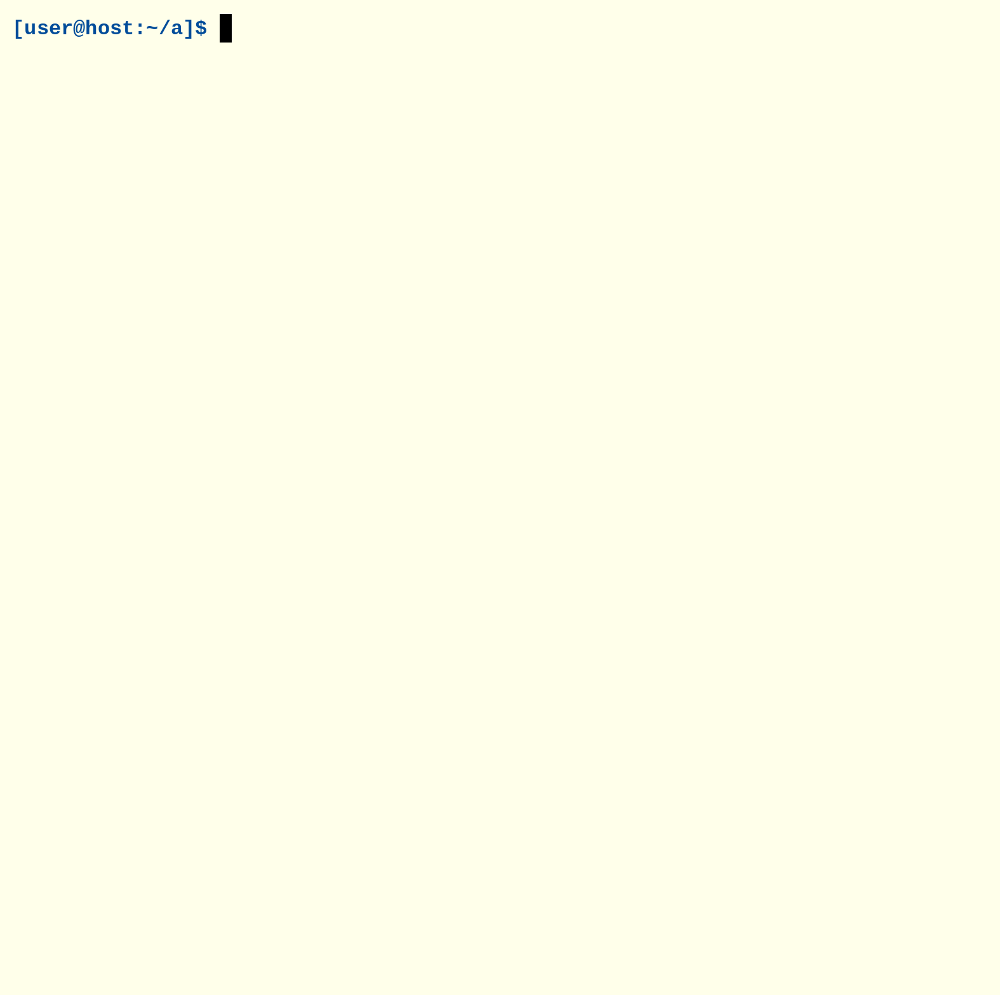

# `a`

The terminal is the standard user interface.
`a` is an llm harness that leaves it alone:
it reads prompts, calls a model, and writes text.
It does not redraw your screen, hijack copy and paste, animate a pet, update itself, lurk as a daemon, or turn configuration into a hobby.



## Install

`a` supports Linux and macOS. Install `a` and its ChatGPT adapter with Go:

```sh
go install github.com/jireva/a@latest
go install github.com/jireva/a/cmd/a-chatgpt-proxy@latest
```

Make sure Go's binary installation directory is on your `PATH`. Alternatively,
install both programs with Nix:

```sh
nix profile install github:jireva/a
```

## Quick start with ChatGPT

`a-chatgpt-proxy` lets `a` use a ChatGPT plan through
[Sign in with ChatGPT](https://developers.openai.com/siwc/token-sharing-open-source).
Sign in, then leave the proxy running:

```sh
a-chatgpt-proxy login            # open the printed link in a browser
a-chatgpt-proxy                  # listen on 127.0.0.1:8080
```

In another terminal, enter the directory you want the model to work in, list
the available models, and choose one:

```sh
a -l
a -n -m MODEL what is tail recursion?
```

Replace `MODEL` with an ID from `a -l`. Model availability can change.

`-n` disables tools. To let the assistant work on a project, enter its directory
and omit `-n`:

```sh
cd /path/to/project
a -m MODEL explain this project
```

**Tools are enabled by default and can modify the current workspace.** Sandbox
protections differ between Linux and macOS; see [Tools and security](doc/tools-and-security.md).

Run `a -m MODEL` without a prompt for an interactive conversation. To use a
local model or another backend, see [Model servers](doc/model-servers.md).

## Documentation

- [Using a](doc/using-a.md)
- [Model servers and adapter configuration](doc/model-servers.md)
- [ChatGPT quick start](doc/chatgpt-proxy.md)
- [Tools and security](doc/tools-and-security.md)
- [Transcripts and compaction](doc/transcripts.md)
- [Subagents](doc/subagents.md)

## License

This project is free software licensed under GPL-3.0-or-later; see
[LICENSE](LICENSE). The bundled prompt text is adapted from OpenAI Codex under
Apache-2.0; see [LICENSE.apache-2.0](LICENSE.apache-2.0).
